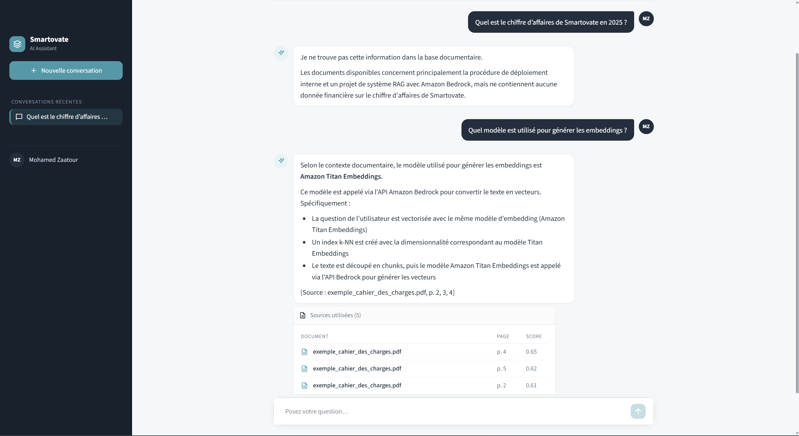
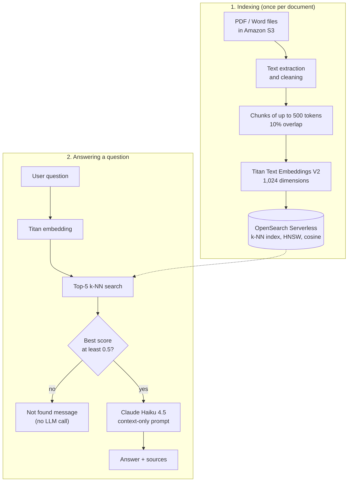
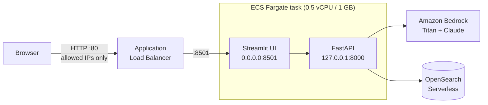

# Smartovate RAG Assistant

An internal AI assistant that answers questions from a company's own documents, **cites its sources**, and **says so when the answer isn't there** instead of making one up.

Built end to end on AWS during a two-month internship at [Smartovate](https://www.smartovate.com) (London, remote): from the UML design to a production deployment defined as code.



<sub>The interface is in French. Top: a question the documents cannot answer ("What was Smartovate's revenue in 2025?") is refused. Bottom: a question about the project is answered, with the document, page and relevance score of each source.</sub>

---

## The problem

Large language models don't know a company's internal documents. Worse, when they don't know, they tend to produce a confident, plausible and wrong answer. For an internal knowledge assistant, a wrong answer is worse than no answer.

## The solution: RAG

**Retrieval-Augmented Generation**: before answering, the system retrieves the most relevant passages from the company's documents, and the model is asked to answer **using only those passages**.



## Key features

- **Cited sources.** Every answer lists the document, page and relevance score of the passages it relies on. The sources are built from the retrieved chunks, not from the model's text, so they cannot be invented.
- **Four guardrails against hallucinations:**
  1. **Relevance threshold**: if the best passage scores below 0.5, the assistant answers "not found" without calling the LLM at all.
  2. **Strict prompt**: the model must answer only from the provided context, and say when the information is missing.
  3. **Temperature 0**: faithful, deterministic answers.
  4. **Trustworthy sources**: built from the real chunks, and hidden when the answer is "not found".
- **Chat interface** (Streamlit) with conversation history.
- **REST API** (FastAPI): `POST /ask`, `GET /health`, interactive docs at `/docs`.
- **Infrastructure as Code**: the vector database and the whole deployment are defined with AWS CDK (Python).

## Tech stack

| Layer | Technology |
|---|---|
| Language | Python 3.11 |
| Embeddings | Amazon Titan Text Embeddings V2 (Amazon Bedrock) |
| LLM | Claude Haiku 4.5 on Amazon Bedrock (Converse API) |
| Vector database | Amazon OpenSearch Serverless (vector search collection) |
| Backend | FastAPI |
| Frontend | Streamlit |
| Packaging | Docker |
| Hosting | Amazon ECS on AWS Fargate, behind an Application Load Balancer |
| Infrastructure as Code | AWS CDK (Python) |
| Quality | pytest (27 tests, no AWS calls), Ruff (PEP 8) |

The pipeline calls AWS directly with `boto3` and `opensearch-py`, without an orchestration framework such as LangChain.

## AWS architecture



- **Two CDK stacks**: `SmartovateRagStack` (OpenSearch Serverless collection and its encryption, network and data access policies) and `SmartovateRagEcsStack` (VPC, load balancer, ECS service, task role).
- **No access keys**: the container gets temporary credentials from a dedicated IAM task role, limited to Bedrock and OpenSearch (least privilege).
- **One container**: the API only listens on `127.0.0.1`, so it is reachable by the interface but not from the internet.
- Dedicated VPC (2 availability zones, public subnets, no NAT gateway), image stored in Amazon ECR, logs in CloudWatch.

## Results

| Metric | Value |
|---|---|
| Response time in production | **1.1 to 1.7 s** per question (vector search ≈ 0.2 s) |
| Container footprint | ≈ 130 MiB of memory, ~1% CPU at rest |
| Full redeployment | 30 AWS resources in about 5 minutes, with one `cdk deploy` |
| Automated tests | 27 (pytest), all AWS calls mocked |
| Code style | Ruff: all checks passed |
| Delivery | 4 Scrum sprints |

## Getting started

### Prerequisites

- An AWS account with access to the Bedrock models *Titan Text Embeddings V2* and *Claude Haiku 4.5* (region `us-west-2`).
- Python 3.11 (conda recommended), Docker Desktop.
- For deployment: Node.js 22 or 24 LTS and the AWS CDK CLI (`npm install -g aws-cdk`).

### 1. Install

```bash
conda create -n rag-smartovate python=3.11
conda activate rag-smartovate
pip install -r requirements.txt
```

Copy `.env.example` to `.env` and fill in your values (AWS profile and region, S3 bucket, OpenSearch endpoint, model ID).

### 2. Create the vector database (once)

```bash
cd infra
pip install -r requirements.txt
# copy infra/.env.example to infra/.env and fill it in
cdk deploy SmartovateRagStack --profile <your-profile>
```

### 3. Index the documents

Put PDF or Word files in your S3 bucket, then, from `src/`:

```bash
python -m indexation.create_index   # create the k-NN index (idempotent)
python -m indexation.bulk_index     # extract, chunk, embed and index all documents
```

### 4. Run the chatbot locally

From `src/`, in two terminals:

```bash
uvicorn api.main:app --reload      # API: http://localhost:8000/docs
streamlit run frontend/app.py      # interface: http://localhost:8501
```

### 5. Run with Docker

```powershell
docker build -t rag-smartovate:1.0 .
# .env.docker = a copy of .env WITHOUT the AWS_PROFILE line
aws configure export-credentials --profile <your-profile> --format powershell | Invoke-Expression
docker run -d --rm --name rag -p 8501:8501 --env-file .env.docker `
  -e AWS_ACCESS_KEY_ID -e AWS_SECRET_ACCESS_KEY -e AWS_SESSION_TOKEN rag-smartovate:1.0
```

### 6. Deploy on AWS

From `infra/` (set `ALLOWED_IPS` in `infra/.env` first):

```bash
cdk deploy SmartovateRagEcsStack --profile <your-profile>    # ~5 min, prints the app URL
cdk destroy SmartovateRagEcsStack --profile <your-profile>   # stop the costs (~$1.2/day)
```

### Tests and linting

```bash
pytest          # from the project root, no AWS calls
ruff check .
```

## Project structure

```
├── src/
│   ├── ingestion/     # text extraction (PDF, Word), cleaning, chunking, embeddings
│   ├── indexation/    # k-NN index creation and bulk indexing in OpenSearch
│   ├── rag/           # semantic search, prompt, generation with Claude, guardrails
│   ├── api/           # FastAPI backend (/ask, /health)
│   └── frontend/      # Streamlit chat interface
├── infra/             # AWS CDK app: OpenSearch stack + ECS Fargate stack
├── tests/             # 27 unit tests (pytest)
├── docs/              # sprint-by-sprint development log (in French)
├── Dockerfile         # single image: private API + public interface
└── requirements.txt   # pinned Python dependencies
```

## Limitations and next steps

- Evaluated on a small test corpus (2 documents, 7 chunks); the 0.5 threshold should be tuned on a larger set of questions.
- The threshold is applied to the best passage only; weaker passages can still reach the prompt.
- Only PDF and Word are supported: no Markdown, no OCR for scanned PDFs, and complex PDF layouts (tables, columns) are partly lost.
- The app is served over HTTP without user authentication (access restricted by IP address).
- Next steps: HTTPS with a custom domain, user authentication, private subnets with VPC endpoints, and an evaluation dataset to measure answer quality.

## Documentation

The detailed development log, sprint by sprint, with design decisions and the problems solved along the way, is in [`docs/journal-de-bord.md`](docs/journal-de-bord.md) (in French).

## Author

**Mohamed Zaatour**, Big Data & Data Analysis student at ISAMM (Tunisia) · [LinkedIn](https://www.linkedin.com/in/mohamed-zaatour-b309a7336)

Internship project at **Smartovate Ltd**, supervised by Abdelkhalek Bakkari (Founder & CEO). Many thanks for his trust and guidance.
